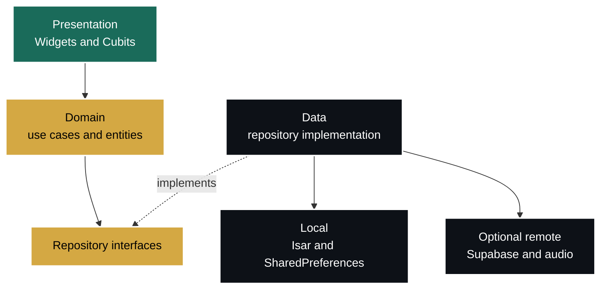

<div align="center">
  

  # تالية — Talia Quran

  **Offline-first Quran reading, memorization, prayer, and azkar. Arabic (RTL) is the primary locale.**

  [](https://flutter.dev)
  [](https://dart.dev)
  [](pubspec.yaml)
  [](#technical-architecture)

  [English](#english) • [العربية](#arabic)
</div>

<br>

Talia (تالية) is an offline-first Flutter app for reading the Mushaf, memorizing with spaced repetition and speech-based recitation checks, tracking a khatmah, keeping prayer times and azkar, and following a kids or adult path. Supabase is optional cloud sync. Without it the app stays local-only.

The bottom navigation has five tabs: Home, Quran, Memorization, Azkar, and Progress. Optional pieces (downloads, notes, hands-free review, group khatmah, the home-screen widget, and others) can be switched from **Settings → App features**.

---

<h2 id="english">English</h2>

### Reading

- Mushaf pages render with [`qcf_quran_plus`](https://pub.dev/packages/qcf_quran_plus). The bundled text is the Tanzil Quran text, Hafs an Asim, Uthmani script. See [Quran text](#quran-text).
- Search, bookmarks, per-ayah notes, and a daily ayah.
- Recitation playback with `just_audio` and `audio_service`, including a chosen ayah range and repeat. Downloaded recitations play without a network. The screen stays on while the reader is open.
- Reader menu controls for memorization strength coloring on the page.

### Memorization

- Adult daily plan and custom plan, plus a guided session (`memorization_plus` and the v2 session engine).
- Spaced repetition, a forgetting forecast, and review scheduled around prayer times.
- Recitation check: on-device speech-to-text compared with the ayah text. Hands-free review uses the microphone without touching the screen.
- Similar-ayah practice, listening review, and surah practice.
- Product rules for the session engine live in [`docs/memorization_v2_product_rules.md`](docs/memorization_v2_product_rules.md).

### Kids and family

- A kids Quran journey: an island map with the Talia character, coins, and juz markers, plus listen, stage, and bedtime flows.
- Guardian linking (QR) and a family dashboard with a child detail view and a monthly report. Progress follows the linked account when cloud sync is configured. The app does not require an account for local use.

### Khatmah

- A personal khatmah with setup, dashboard, history, completion, and a read-confirmation step.
- A group khatmah so people can follow one another’s progress.
- Khatm dua, shown from the approved bundled text.

### Prayer, azkar, and seasons

- Prayer times (`adhan`) and Adhan playback on Android through `talia_prayer_delivery`.
- An opt-in prayer companion (it starts off) for preparation, check-in, and follow-up reminders. Confirmation is always an explicit user action.
- Azkar with counters, including after-prayer azkar in their time window. Only approved records in `assets/data/azkar_release.json` are shown.
- A seasons companion for Hijri occasions (Sha'ban, Ramadan and the last ten nights, Shawwal, Dhul-Hijjah, Hijri new year, Ashura, Friday / Al-Kahf, the white days, and Monday–Thursday fasting). Each season can be turned off, and season reminders are capped at one per day.

### Progress and the home screen

- Streaks, XP, badges, and a completion certificate.
- A home-screen widget summarizing prayer and progress. Its contents follow the feature switch in Settings.
- Local backup and restore, the privacy policy, sources and licenses, and the page **How we protect content and your privacy**.
- Google Play in-app updates via `in_app_update`.

### Quran text

`assets/data/quran.json` is the verbatim Tanzil text. The app does not rewrite it for layout. Display separates the basmalah at runtime; the stored record stays intact.

> Tanzil Quran Text Copyright (C) 2007-2021 Tanzil Project  
> License: Creative Commons Attribution 3.0  
> https://tanzil.net

The same notice is shown in the app under **Settings → Sources & licenses**. Do not edit canonical files under `assets/data/` to satisfy a UI change. Content rules are in [`docs/TALIA_ISLAMIC_CONTENT_SOURCES_POLICY.md`](docs/TALIA_ISLAMIC_CONTENT_SOURCES_POLICY.md).

<h2 id="technical-architecture">Technical architecture</h2>

Features live in `lib/features/<feature>/{data,domain,presentation}`. Repositories return a `dartz` `Either`. Presentation state uses `flutter_bloc` Cubits. Shared systems (routing, storage, sync, the memorization engine, prayer delivery) live in `lib/core/`.



Dependency injection is manual `get_it` registration in `lib/core/di/injection.dart`. `build_runner` does not generate the locator. It generates Isar schemas (`*.g.dart`) and mockito mocks. A new Isar model or `@GenerateMocks` test must be listed in `build.yaml` or nothing is generated for it.

```text
lib/
├── core/                     # DI, GoRouter, theme, l10n, sync, memorization engine
└── features/
    ├── quran/                # Reader, search, audio, downloads
    ├── hifz/                 # Recitation practice
    ├── memorization_plus/    # Plans, kids journey, guardian, similar ayahs
    ├── khatmah/              # Personal khatmah
    ├── group_khatmah/        # Shared khatmah
    ├── azkar/
    ├── prayer_companion/
    ├── seasons/
    ├── progress/
    ├── home/
    └── settings/             # Features, backup, sources, labs
```

Localization is generated from ARB (`flutter: generate: true` in `pubspec.yaml`). `app_ar.arb` is the template. New keys go in both `app_ar.arb` and `app_en.arb`, then `flutter gen-l10n`.

### Tech stack

| Area | Packages |
|---|---|
| App | Flutter `>=3.44`, Dart `^3.12` (`pubspec.yaml`) |
| State and DI | `flutter_bloc`, `get_it` |
| Routing | `go_router` |
| Local data | `isar_community` 3.3.2, `shared_preferences`, `flutter_secure_storage` |
| Sync | `supabase_flutter` (optional), `workmanager` |
| Audio and speech | `just_audio`, `audio_service`, `speech_to_text`, `qcf_quran_plus` |
| Prayer and time | `adhan`, `talia_prayer_delivery`, `hijri`, `flutter_local_notifications` |
| Home screen | `home_widget` |

### Getting started

Requirements: Flutter `>=3.44` and the Dart SDK from `pubspec.yaml` (`^3.12.0`).

```bash
git clone https://github.com/sayedsaad96/talia_quran.git
cd talia_quran
flutter pub get
flutter gen-l10n
dart run build_runner build --delete-conflicting-outputs
flutter run
```

`flutter run` without defines starts the app local-only. Cloud sync turns on only when both defines are set and the URL starts with `https://`:

```bash
flutter run --dart-define=SUPABASE_URL=https://<project>.supabase.co --dart-define=SUPABASE_ANON_KEY=<anon-key>
```

Supabase schema source of truth is `supabase/migrations/`, applied in lexical order. See [`supabase/README.md`](supabase/README.md).

### Checks

```bash
flutter analyze
flutter test
flutter test test/path/to/file_test.dart
```

On Windows, the release gate is `./scripts/verify_v1_release.ps1`. It enforces the lockfile, regenerates l10n and Isar code, runs analysis and tests, and checks the Supabase migrations. Add `-BuildAndroidRelease` to build the app bundle as well.

---

<h2 id="arabic" align="right">العربية</h2>

<div align="right" dir="rtl">

**تالية** تطبيق Flutter يعمل بلا اتصال أولًا: قراءة المصحف، الحفظ والمراجعة، الختمة، مواقيت الصلاة والأذكار، ومسار للأطفال وآخر للكبار. المزامنة السحابية عبر Supabase اختيارية. من دونها يبقى كل شيء على الجهاز.

التنقل السفلي خمسة تبويبات: الرئيسية، القرآن، الحفظ، الأذكار، وتقدمي. المزايا الاختيارية (التنزيل، الملاحظات، المراجعة بلا يدين، الختمة الجماعية، أداة الشاشة الرئيسية، وغيرها) تُفتح وتُغلق من **الإعدادات ← مزايا التطبيق**.

### القراءة

- صفحات المصحف عبر `qcf_quran_plus`. النص المضمّن نص تنزيل، برواية حفص عن عاصم وبالرسم العثماني. التفصيل في قسم [نص القرآن](#quran-text).
- بحث، علامات، ملاحظة على الآية، وآية اليوم.
- تلاوة صوتية مع تكرار مدى تحدده. التلاوات المنزّلة تُسمع بلا إنترنت. الشاشة تبقى مضاءة أثناء القراءة.
- تلوين قوة الحفظ على صفحة المصحف من قائمة القارئ.

### الحفظ

- خطة يومية وخطة مخصصة للكبار، وجلسة حفظ موجّهة.
- تكرار متباعد، وتوقع لما يقارب النسيان، ومراجعة قصيرة بعد الصلاة.
- فحص التلاوة: تحويل الكلام إلى نص على الجهاز ومقارنته بنص الآية. المراجعة بلا يدين تعتمد الصوت من غير لمس الشاشة.
- تدريب المتشابه، ومراجعة بالسمع، وتدريب على السورة.
- قواعد جلسة الحفظ في [`docs/memorization_v2_product_rules.md`](docs/memorization_v2_product_rules.md).

### الأطفال والأسرة

- رحلة قرآن للأطفال: خريطة جزر مع شخصية تالية، وعملات، وعلامات للأجزاء، مع الاستماع والمراحل ووقت النوم.
- ربط ولي الأمر برمز QR، ولوحة عائلة فيها تفاصيل الطفل وتقرير شهري. المتابعة عن بعد تعمل عندما تكون المزامنة السحابية مهيأة. الاستخدام المحلي لا يحتاج حسابًا.

### الختمة

- ختمة شخصية: إعداد، لوحة، سجل، إتمام، وتأكيد القراءة.
- ختمة جماعية لمتابعة تقدم المشاركين.
- دعاء الختم من النص المعتمد المضمّن.

### الصلاة والأذكار والمواسم

- مواقيت الصلاة والأذان على أندرويد.
- رفيق صلاة اختياري (مغلق افتراضيًا) للتذكير قبل الصلاة وبعدها. تأكيد الصلاة يبقى فعلًا صريحًا من المستخدم.
- أذكار بعدّادات، ومنها أذكار بعد الصلاة في وقتها. لا يُعرض إلا ما اعتُمد في `assets/data/azkar_release.json`.
- رفيق مواسم للتواريخ الهجرية: شعبان، رمضان والعشر الأواخر، ست شوال، عشر ذي الحجة، رأس السنة، عاشوراء، الجمعة وسورة الكهف، الأيام البيض، وصيام الاثنين والخميس. كل موسم يُطفأ على حدة، وتذكيرات المواسم بحد أقصى تذكير واحد في اليوم.

### التقدم والشاشة الرئيسية

- السلاسل، ونقاط الخبرة، والأوسمة، وشهادة الإتمام.
- أداة شاشة رئيسية تلخص الصلاة والتقدم، وتتبع مفتاح الميزة في الإعدادات.
- نسخ احتياطي محلي واستعادة، وسياسة الخصوصية، والمصادر والتراخيص، وصفحة **كيف نحفظ المحتوى وخصوصيتك**.
- تحديث داخل التطبيق عبر Google Play.

### التشغيل

```bash
git clone https://github.com/sayedsaad96/talia_quran.git
cd talia_quran
flutter pub get
flutter gen-l10n
dart run build_runner build --delete-conflicting-outputs
flutter run
```

التشغيل من دون معرّفات يبقى محليًا. المزامنة تحتاج العنوانين معًا، وعنوانًا يبدأ بـ `https://`:

```bash
flutter run --dart-define=SUPABASE_URL=https://<project>.supabase.co --dart-define=SUPABASE_ANON_KEY=<anon-key>
```

حقن الاعتمادات يدوي في `lib/core/di/injection.dart`. أمر `build_runner` يولّد مخططات Isar والقوالب الاختبارية فقط، ولا يولّد `get_it`. مفاتيح الترجمة تُضاف إلى `app_ar.arb` و`app_en.arb` ثم `flutter gen-l10n`.

لا يُعدَّل `assets/data/quran.json` لأجل الواجهة. إشعار تنزيل ظاهر في التطبيق تحت **الإعدادات ← المصادر والتراخيص**:

> Tanzil Quran Text Copyright (C) 2007-2021 Tanzil Project  
> License: Creative Commons Attribution 3.0

سياسة المصادر: [`docs/TALIA_ISLAMIC_CONTENT_SOURCES_POLICY.md`](docs/TALIA_ISLAMIC_CONTENT_SOURCES_POLICY.md).

</div>
