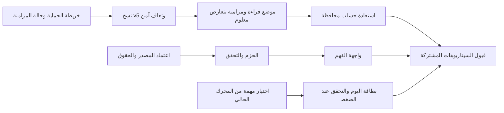

# تصميم المبادرات الثلاث: حماية التقدم، الفهم، والمراجعة اليومية

التاريخ: 2026-10-31. تحديث 2026-11-01: صرح المستخدم بالتنفيذ المحلي والمراجعة والاستكمال. الحالة الفعلية وبوابات القبول المتبقية في [سجل التنفيذ](../../release/2026-10-31-three-initiatives-validation.md)؛ لا يعد هذا تصريحًا بنشر الخادم أو اعتماد المحتوى الديني.
مرجع الفحص: HEAD `f356f44a` مع قراءة الملفات الحالية. توجد تعديلات سابقة في README.md خارج نطاق هذا العمل.

## الهدف

تنفيذ المبادرات التي اختارها المستخدم من المقارنة البحثية: حماية التقدم واستعادته، إضافة الفهم المعتمد بجوار الآية، وربط المراجعة الحالية بمهمة يومية تناسب وقت المستخدم.

## ما ثبت من المستودع

- النسخ الاحتياطي v4 موجود، لكنه يستثني العلامات وموضع الاستئناف، ويمنع الاستعادة للحساب المسجل. `lib/core/backup/` و`lib/features/settings/presentation/pages/backup_page.dart`.
- `BookmarkService` يملك تخزينًا مشفرًا للحساب، ومزامنة بإصدارات وحذف منطقي. لا يُستبدل بآلية موازية.
- `read_pages` سجل صفحات مقروءة يتزامن بالاتحاد. ليس موضع متابعة القراءة. `AppSessionService` يحفظ موضعًا محليًا يتسع لمسارات أخرى غير المصحف؛ لا ينقل خامًا بين الأجهزة.
- لم يظهر تفسير/ترجمة في خيارات الآية الحالية. سياسة المصادر موجودة، وأي نشر محتوى جديد يتطلب تحقق المصدر والحقوق والمراجعة.
- وقت اليوم 5/10/20 دقيقة، وتوصيات المراجعة، وأولوية استكمال الجلسة، والعودة الهادئة موجودة. لا حاجة لمحرك جدولة جديد.
- الفحص ساكن؛ لم تُشغّل اختبارات أو التطبيق، ولم يُتحقق من حالة الخادم المنشور.

## البدائل والقرار المقترح

| المبادرة | بديل | المقايضة | المقترح |
|---|---|---|---|
| حماية البيانات | فتح الاستيراد الحالي للحساب | أسرع ظاهريًا، لكنه لا يوقف جميع الكتابات والمزامنة | مرفوض قبل ضمانات التعافي |
| حماية البيانات | توسيع تدريجي للنسخة + موضع قراءة مضبوط + مصالحة استعادة | أكثر خطوات، ويحافظ على البيانات والعملاء القدماء | موصى به |
| الفهم | طلب مباشر من API أثناء القراءة | بدء سريع، واعتماد على الشبكة وتحديث محتوى غير مضبوط | يؤجل |
| الفهم | حزم محلية بإصدار ومصدر وحقوق ومراجعة | إصدار المحتوى يمر ببوابة اعتماد؛ يعمل دون شبكة | موصى به للإصدار الأول |
| مهمة اليوم | إنشاء محرك جديد وخطة مستقلة | ازدواج سلطة الحفظ والإنجاز | مرفوض |
| مهمة اليوم | عرض توصية واحدة من النظام الحالي | نطاق أصغر، ويحافظ على التقدم ومعايير الإنجاز | موصى به |

هذه قرارات اقترحها المخطط، وليست موافقات سابقة من المستخدم.

## النطاق ومعايير القبول

### A. حماية التقدم واستعادته

1. شاشة «حماية بياناتي» تفصل حفظ الجهاز، النسخة المصدرة، ومزامنة الحساب. لا تعرض «تمت المزامنة» إذا نجح جزء وفشل آخر.
2. ملف v5 يضيف علامات حية وموضع مصحف مضبوطًا، ويقرأ v1–v4 دون مسح الأقسام التي لم تكن موجودة.
3. موضع المصحف هو صفحة 1..604 في القراءة العادية فقط. لا ينقل مسارًا أو جلسة حفظ أو ختمة أو هوية أسرة.
4. فصل محفوظات الصفحات المقروءة عن موضع الاستئناف؛ الموضع لا يثبت القراءة ولا يمنح نقاطًا.
5. تبقى الاستعادة المسجلة ممنوعة حتى تنفذ بوابة إيقاف جميع الكتابات وخطة المصالحة والتعافي من انقطاع العملية.
6. استعادة الحساب في هذا الإصدار: تقدم الحساب من مسار السحابة القائم، ومن الملف يسمح باستيراد علامات إضافية وموضع مصحف مختار فقط. استبدال تقدم الحساب كاملًا من الملف خارج هذا الإصدار، ويبقى محجوبًا حتى توجد سياسة مصالحة لكل مجال. لا حذف لتقدم/علامات الحساب أو تكرار نقاط/جوائز، ولا يُعرض الملف القديم كأنه أحدث من السحابة. هذه حدود النطاق المنفذ محليًا.
7. تعارض موضع جهازين: كشف التعارض بإصدار خادم، والحفاظ على الموضع المحلي المعلق، واختيار صريح بين الموضعين؛ لا حسم بساعات الأجهزة.
8. PIN والأذونات والمفاتيح وتسجيلات الصوت وإعدادات الجهاز ليست جزءًا من النقل. ملف gzip+SHA الحالي ليس ملفًا مشفرًا، ويجب توضيح ذلك عند التصدير.

### B. الفهم المعتمد بجوار الآية

1. تفسير عربي واحد: التفسير الميسر مرشح أول وفق سياسة المشروع؛ لا يثبت مصدره أو حق إعادة توزيعه حتى توثق نسخة بعينها. ترجمة إنجليزية واحدة من QuranEnc، ويثبت مفتاح العمل وإصداره قبل الاستيراد.
2. تبويبان واضحان «التفسير» و«ترجمة المعاني» منفصلان عن النص القرآني؛ الواجهة لا تعتمد لغة محتواهما على لغة التطبيق.
3. مصدر وإصدار وحواشٍ أصلية ورابط المصدر داخل العرض، مع بلاغ يجهزه المستخدم دون إرسال تلقائي.
4. عرض آية أو نطاق آيات بحسب بنية المصدر؛ لا تقطيع أو تلخيص أو إعادة صياغة للنص المنقول.
5. المحتوى المعتمد متاح محليًا. غياب الحزمة أو تلفها يعطل طبقة الفهم فقط، ويترك المصحف والاستماع صالحين.
6. لا تعديل لـ`assets/data/quran.json` أو معرّفات الآيات أو رسم المصحف. لا نشر محتوى مولد أو غير مرخص.

### C. مهمة مراجعة يومية واضحة

1. للبالغ المؤكد فقط في هذا الإصدار؛ رحلة الأطفال لا تتغير.
2. استكمال جلسة قائمة له الأولوية؛ ثم المراجعة المستحقة وفق المحرك الحالي. لا تتجاوز البطاقة تنبيهًا حرجًا أو ترتيب الصفحة الرئيسية الحالي.
3. اختيار 5/10/20 دقيقة كما هو حاليًا؛ المدة تقريبية. إذا لم توجد مراجعة تلائمها يوضح ذلك، ويتيح اختيار وقت آخر أو متابعة المهمة الأطول بقرار المستخدم.
4. لا تقسيم صامت لجلسة، ولا كتابة `blockSize` أو تبديل `intent` في المسار المحسوم، ولا إيقاف الصوت عند نفاد الوقت.
5. البطاقة تعرض مهمة واحدة وسببها ومدة تقريبية، مع «خيارات أخرى» للوصول إلى المسار الحالي.
6. الضغط لا يسجل إنجازًا. الحفظ والجوائز يتمان عبر القنوات الحالية فقط؛ العودة من الجلسة تعيد قراءة الحالة الموثوقة.
7. دون سجلات مراجعة: حالة واضحة تقود إلى البداية المناسبة. انتهاء المهمة لا يضع علامة «أنجزت وردك» ما دام لا يوجد دليل مطابق.
8. تبديل الحساب أو تحول الملف إلى طفل أو عبور منتصف الليل يبطل الاقتراح القديم، ويعاد حسم الوجهة عند الضغط.

## قيود التنفيذ المشتركة

- Clean Architecture؛ Cubit فقط؛ Repository/UseCases/DI؛ لا وصول مباشر للتخزين من UI.
- Dart SDK `^3.12.0` وFlutter `>=3.44.0` كما في pubspec؛ لا ترقية حزم ضمن هذه المبادرات.
- العربية والإنجليزية وRTL/LTR، والوضعان الليلي والنهاري، وTalkBack وتكبير 200% في الواجهات الجديدة.
- لا تغيير للنص القرآني أو معرّفاته أو قواعد احتساب إتقان/نقاط لمجرد عرض بطاقة أو تفسير أو استعادة.
- لا نشر SQL على الإنتاج ولا اعتماد محتوى شرعي تلقائيًا؛ التنفيذ المحلي والتحقق يسبقان أي نشر.
- كل ميزة لها مفتاح تفعيل يبدأ مغلقًا حتى اجتياز قبولها. إغلاق المفتاح لا يحذف بياناتها ولا يجعل النسخ الجديدة غير قابلة للقراءة.
- الملفات المقترحة أسماء تنفيذية جديدة؛ يعاد فحص التعارضات والمسارات عند بدء التنفيذ.

## الترتيب والتبعيات

الأولوية للمسار A، مع بدء التحقق من حقوق B مبكرًا. B وC لا يحتاجان انتظار نشر مخطط A. إطلاق كل مسار مستقل بعد قبوله.

## تقدير مبدئي للتخطيط لا التزام زمني

- A: نحو 12–18 يوم عمل هندسي، وهو الأكثر حساسية ويتضمن مراجعة تصميم التعافي والتزامن.
- B: نحو 6–9 أيام بعد توافر المادة والحقوق؛ مدة انتظار الاعتماد منفصلة وغير معلومة.
- C: نحو 4–6 أيام؛ تعمد النطاق عدم إنشاء مجدول أو سجل إنجاز جديد.
- قبول مشترك: 3–4 أيام. الإجمالي التسلسلي نحو 25–37 يوم عمل لمطور متفرغ؛ يعاد التقدير بعد المهمة الأولى لكل مسار.

## بوابات المراجعة والقرار

بدأ التنفيذ بتصريح المستخدم استكمال العمل. يبقى نشر الخادم واعتماد المواد الدينية وقبول الإطلاق قرارات مستقلة، موثقة في سجل التنفيذ. لا يطلب تأكيد جديد لكل خطوة روتينية مصرح بها.

## مراجع المصادر التي فُحصت

- [سياسة المشروع](../../TALIA_ISLAMIC_CONTENT_SOURCES_POLICY.md).
- [QuranEnc API](https://quranenc.com/ar/home/api)، فُحص 2026-10-31: يصف إصدار الترجمة وحواشيها، والتفسير على هيئة كتل قد تغطي نطاقًا. هذا يثبت شكل الواجهة ولا يمنح وحده ترخيص نشر.
- رابط المجمع المسجل في السياسة `https://qurancomplex.gov.sa/en/techquran/dev/` تعذر جلبه وأعاد 404 بأداة التصفح. مهمة B1 تتعقب صفحة المصدر الحالية وتوثق الحقوق؛ لا يُعد ذلك إثبات عدم وجود المصدر.
